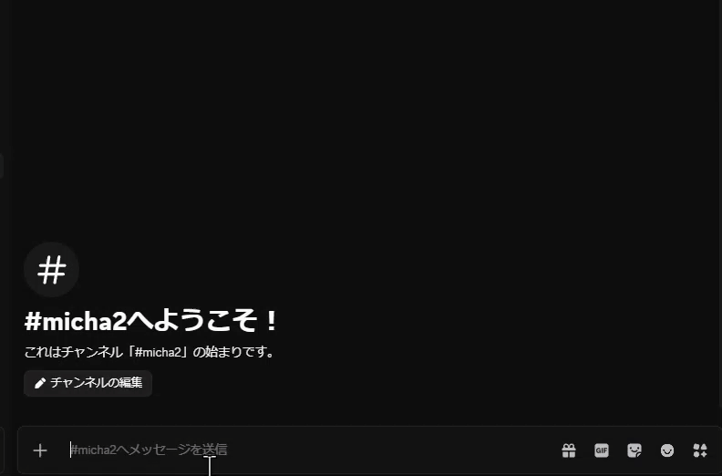
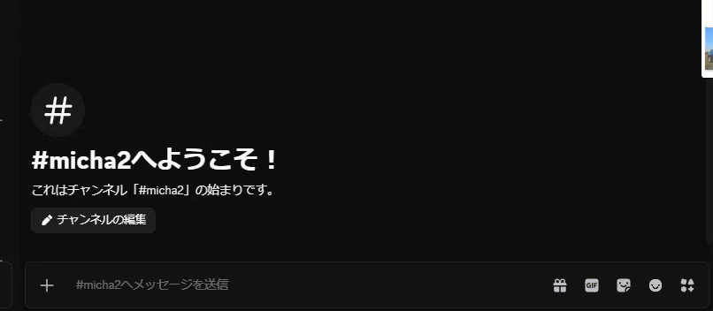

<p align="center">
  <a href='./README.md'>日本語</a> | <a href='./README-en.md'> English </a>
</p>

# Micha

<p align="center">
  
</p>

## 概要
Micha  (ミカ と発音) は Discord コミュニティをより盛り上げるための LLM チャット Bot アプリケーションです。
シンプルで堅牢ながら、現代の LLM チャット Bot に必要な機能を備えています。

Why Micha ?
→ Inspired by [Micha Jawkân-chan](https://www.symphogear-gx.com/characters/micha.php)

<p align="center">
  
</p>

<p align="center">
  
</p>


## 特徴
Micha は以下のようなことができます。

### Micha とのチャット
- テキストチャットのほかアップロードした画像の読み取りにも対応
- Bot が会話したり、読み取ったりできるチャンネルをカテゴリ単位で制限可能
- 設定する人格や指示を Markdown 形式で指定可能
- 簡易的なシェルコマンドの実行にも対応
  - 実行ごとに使い捨てのDocker コンテナを立ち上げる仕組み
- 読み取り専用に設定したチャンネルを定期巡回し話題へ反映
- ベクトル化DBと連携した高度な長期記憶を保持
- Web 上の検索、X(Twitter)リンク内の本文・画像取得に対応

### Micha とのインタラクション
- インタラクション機能
  - Bot からの自発的な発言
  - 絵文字によるランダムなインタラクション

### OpenAI 互換 API への対応状況
- 動作確認済 API
  - OpenAI 純正 API
  - OpenCode Go API
- API エンドポイントを複数登録可能
  - たとえばテキストチャットには OpenCode Go の API を利用し、Embedding にのみ OpenAI 純正API を利用するなどの使い方が可能

### コンテナ環境を前提とした設計
- Docker イメージの提供
- Kubernetes へのデプロイにネイティブに対応

## クイックスタート
### 事前準備
- Discord Developer ポータルページでアプリケーションを作成し、Bot トークンを入手
  - Privileged Intent を有効にしてください
- 検索機能を有効にしたい場合、Brave API キーを入手

### 初期設定
設定は `config.toml` のみから読み込む。
config.toml のパスは `CONFIG_PATH` にて指定する。

```sh
cp config.example.toml config.toml
vim config.toml
## 以下の設定項目一覧にしたがって編集
```

### 設定項目一覧

| セクション | キー | 内容 | 既定値 |
|---|---|---|---|
| `bot` | `id` | Bot識別名（ログ表示用） | `micha-bot` |
| | `display_name` | Botの表示名（通知・履歴記録用） | `micha-bot` |
| | `respond_all` | Bot がメンション無しで指定したチャンネルの全発言に応答するか | `false` |
| `discord` | `token` * | Discord の Botトークン | — |
| | `guild_id` * | 導入対象サーバID | — |
| | `category_ids` * | Bot が応答するカテゴリID | — |
| | `readonly_channel_ids` | ここで指定したチャンネルを Bot は定期巡回し、話題を収集する | 空 |
| | `readonly_poll_sec` | 読取専用の取込間隔（秒） | `300` |
| | `login_notice_channel_id` | ログイン時の通知先。空の場合は対象カテゴリの先頭のチャンネル | 空 |
| `database` | `url` * | Postgres DBへの接続URL | — |
| `endpoints.<name>` | `base_url` | 名前付きエンドポイントのURL。用途別に複数定義できる | — |
| | `api_key` | エンドポイントの API キー | — |
| | `extra_headers` | 追加HTTPヘッダ（例：`x-opencode-session`） | 空 |
| `models` | `chat` | 応答用モデル。`"<エンドポイント>/<モデル>"` 形式で指定 | — |
| | `embedding` | 記憶用モデル。`"<エンドポイント>/<モデル>"` 形式で指定 | — |
| | `embedding_dim` | 長期記憶用ベクトル次元（通常変更不要。DBと一致させる） | `1536` |
| `brave` | `api_key` | Web 検索に使用する Brave API のキー。未設定の場合 Web 検索不可 | 空 |
| `persona` | `path` | Bot の人格を定義するペルソナファイル。未設定の場合、デフォルトのペルソナを使用 | 空 |
| `random_talk` | `probability` | Bot がチャンネルでランダム発言する確率 | `0.02` |
| `random_talk` | `cooldown_sec` | Bot がチャンネルでランダム発言する間隔(秒) | `1800` |
| `memory` | `history_limit` | Bot が参照するチャットの履歴件数 | `20` |
| `memory` | `top_k` | Bot が想起する記憶の件数 | `5` |
| `reaction` | `probability` | Bot が絵文字でリアクションする確率 | `0.15` |
| `reaction` | `cooldown_sec` | Bot が絵文字でリアクションする間隔(秒) | `600` |
| `shell` | `enabled` | Bot によるシェルコマンド実行可否 | `true` |
| `shell` | `image` | Bot によるシェルコマンド実行時の Docker イメージタグ | `alpine:latest` |
| `shell` | `timeout_sec` | Bot によるシェルコマンド実行上限(秒) | `30` |
| `server` | `health_addr` | ヘルスチェック待受ポート | `:8080` |

*は必須項目である。

### Docker Compose での起動
初期設定を済ませてから実行する
```sh
git clone https://github.com/haya58/micha.git
cd micha/docker
docker compose up -d
docker compose logs -f bot  # "bot started" が出ればOK
```

-  `../config.toml` をコンテナにマウントする
- DBは `pgvector/pgvector:pg16` が自動起動し、マイグレーションはBot起動時に自動適用。DB実体はリポジトリ直下の `botdb/` に保存される
- シェル実行用にDinD（`dind` サービス）が同梱される
  - Botは `DOCKER_HOST=tcp://dind:2375` で接続する。
- 同一ホストで複数Botを運用する場合は、ペルソナごとにTOMLファイル（例：`config-kuro.toml`）を用意し、`docker-compose.yml` のマウント先を変えたサービスを追加すること。
  - DBは `create-dbs.sh` で自動作成する。

## k8s環境へのデプロイ
-  `k8s/secret.yaml` 内の config.toml を編集する
- 適用する

```sh
kubectl apply -k .  # リポジトリルートで実行
```
- Bot（ペルソナ）を複数起動する場合、Bot ごとに Secret・Deployment を複製し、`database_url` のdbname のみ変える。
- `kustomization.yaml` が `k8s/` 内マニフェストと `persona/` 内ペルソナファイルを束ねる。
- デプロイ対象のペルソナに合わせて `kustomization.yaml` の `files` を書き換える。

DinDサイドカー（`dind` コンテナ）が使い捨て実行を担い、Botは `DOCKER_HOST=tcp://localhost:2375` で接続する。`/healthz` がliveness/readiness probeに設定済みである。

## Docker イメージのビルド

- `main` ブランチへのpushで `.github/workflows/docker-publish.yml` が Linux/amd64 イメージをビルド
- `ghcr.io/<owner>/<repo>:latest` と short SHAタグでプッシュ
